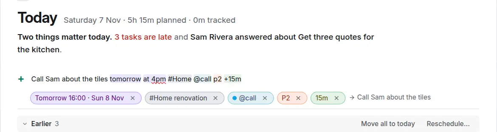
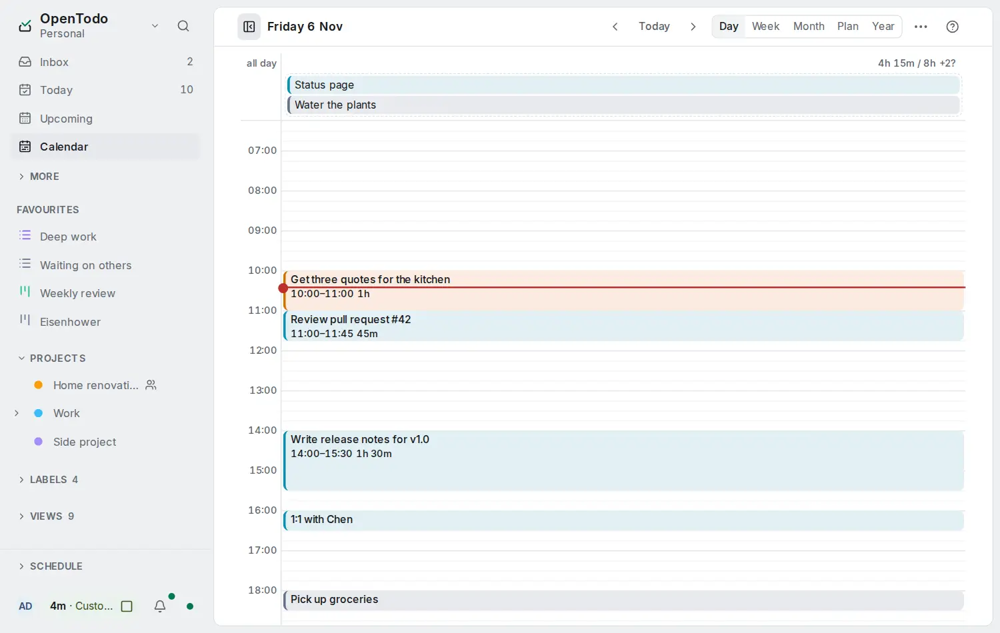
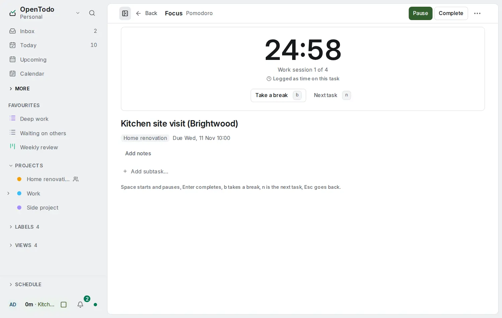
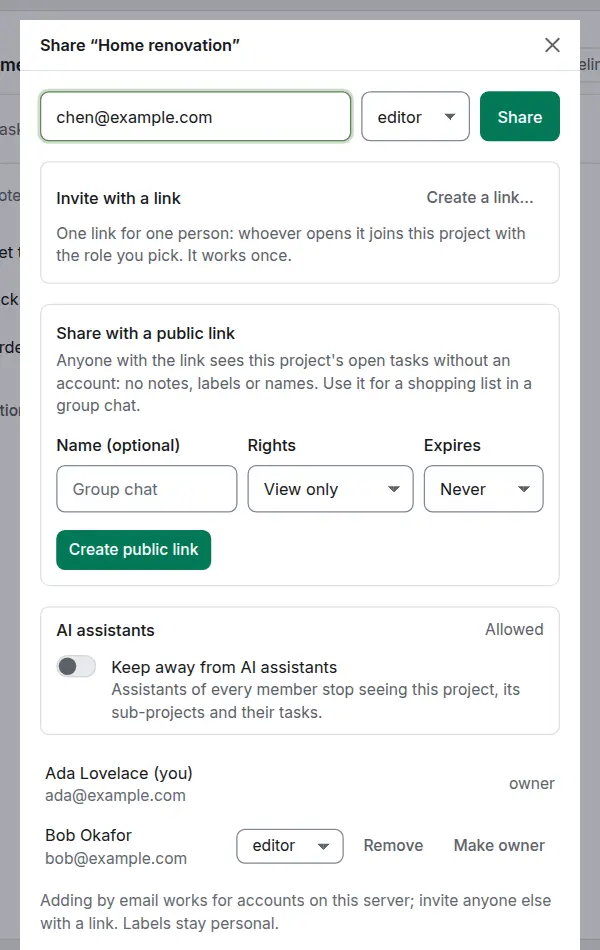
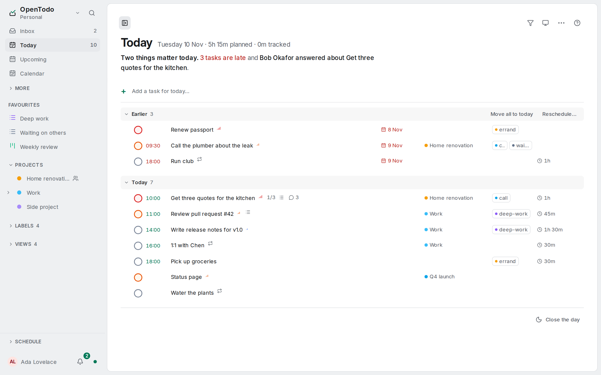
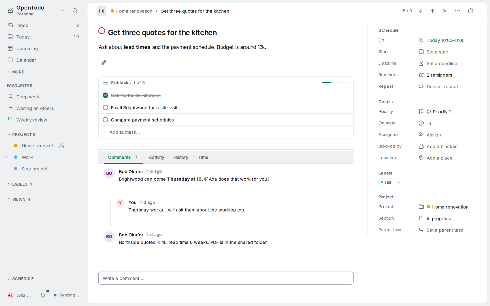
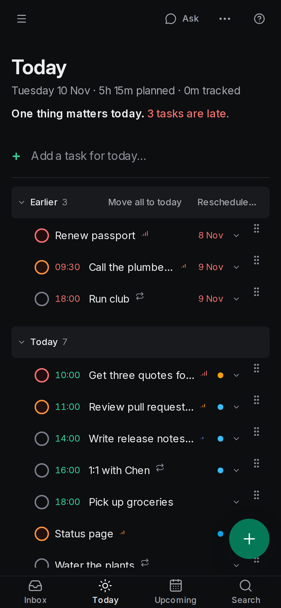
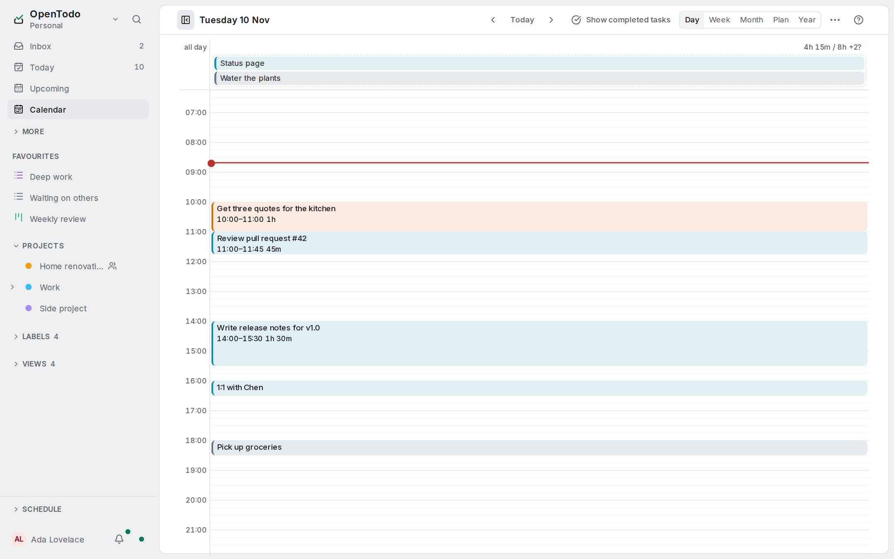

<p align="center">
  
</p>

<h1 align="center">OpenTodo</h1>

<p align="center"><strong>Plan your day without renting your to-do list.</strong></p>

<p align="center">OpenTodo is a free, open-source to-do app you run on your own server or have hosted for you. It works on your phone and your computer, even offline, shares lists with your family or your team, and keeps your data with you.</p>

<p align="center">
  <a href="https://demo.open-todo.app"><strong>Try the demo</strong></a> ·
  <a href="#install"><strong>Install</strong></a> ·
  <a href="https://open-todo.app/docs/"><strong>Docs</strong></a> ·
  <a href="https://open-todo.app"><strong>Website</strong></a>
</p>

<p align="center">
  <a href="LICENSE"></a>
  <a href="https://github.com/nufuturepro/OpenTaskKit/actions/workflows/ci.yml"></a>
  <a href="https://github.com/nufuturepro/OpenTaskKit/releases/latest"></a>
  <a href="https://github.com/nufuturepro/OpenTaskKit/pkgs/container/opentaskkit"></a>
  
  
  <a href="https://www.opensourcealternatives.to"></a>
  <a href="https://github.com/sponsors/pixari"></a>
  <a href="https://buymeacoffee.com/pixari"></a>
  <a href="https://discord.gg/mmSsuCRduD"></a>
</p>

<p align="center">
  <a href="https://demo.open-todo.app"><strong>Try the demo</strong></a> (no sign-up) ·
  <a href="#quick-start"><strong>Install in 2 minutes</strong></a> ·
  <a href="https://open-todo.app/docs/"><strong>Read the docs</strong></a> ·
  <a href="https://open-todo.app"><strong>Website</strong></a>
</p>

<p align="center">If OpenTodo looks useful, a star on GitHub helps other people find it, and <a href="https://github.com/sponsors/pixari">sponsoring</a> or <a href="https://buymeacoffee.com/pixari">a coffee</a> helps me keep building it.</p>

<p align="center"><strong>This repository is a <a href="https://github.com/pixari/OpenTodo">pixari/OpenTodo</a> fork</strong>, kept close to upstream: features and general bug fixes come from upstream, generic fixes found here are sent upstream first (see <a href="FORKING.md">FORKING.md</a> for the sync workflow), and this fork's own additions ride on top until they are proposed upstream.</p>

---

<p align="center">
  
</p>

**Ways to run it:** [PikaPods](https://www.pikapods.com/apps/opentodo) (hosted, no server needed) · [Docker](docs/self-hosting/docker.md) · [Umbrel](docs/self-hosting/umbrel.md) (coming soon) · [Unraid](docs/self-hosting/unraid.md) · [Home Assistant](docs/self-hosting/home-assistant-addon.md) · [Kubernetes (Helm)](docs/self-hosting/kubernetes.md) · [Single binary](#single-binary) · [Android app](docs/android-app.md) (APK from GitHub; Google Play and F-Droid coming soon) · [all 20 platforms](docs/self-hosting/README.md)

## How it works

### 1. Capture

Type a task the way you say it: `Call Sarah next Wed 3pm #work p1` sets the date, time, project and priority. Dictate it, send a page from your phone's share menu, or forward an email. Anything without a home lands in the Inbox. [Quick add](docs/quick-add.md) · [Voice](docs/quick-add.md#voice) · [Capture](docs/capture.md)

<picture><source media="(prefers-color-scheme: dark)" srcset="docs/images/quick-add-dark.webp"></picture>

### 2. Plan your day

Today shows what is due and what is still open from earlier. Give tasks an estimate and drag them onto the Day or Week calendar to see whether the day fits. [Today](docs/today-and-upcoming.md) · [Time blocking](docs/time-blocking.md)

<picture><source media="(prefers-color-scheme: dark)" srcset="docs/images/day-dark.webp"></picture>

### 3. Focus

Open one task in Focus and start a Pomodoro, Flowtime or countdown timer. The time is logged to the task. [Focus](docs/focus.md)

<picture><source media="(prefers-color-scheme: dark)" srcset="docs/images/focus-dark.webp"></picture>

### 4. Share

Share a project with your family or your team as viewer, editor or admin. Assign tasks, comment, and see what changed. Everyone can edit offline. [Sharing](docs/sharing.md)

<picture><source media="(prefers-color-scheme: dark)" srcset="docs/images/share-dialog-dark.webp"></picture>

## Highlights

- **Your data stays yours.** Everything lives in one folder on your server. Export it at any time, import it anywhere, and schedule backups, encrypted if you like, to disk, S3 or WebDAV. [Backups](docs/backups.md) · [Import and export](docs/import-export.md)
- **Works offline on every device.** Each phone and computer keeps a full copy, so the app works with no connection and syncs when it's back. [Install the app](docs/install-app.md)
- **Bring your tasks.** Import from Todoist, TickTick, Things, Super Productivity, Microsoft To Do, Apple Reminders and more, with a preview and undo. [Import](docs/import.md)
- **Private by design.** No telemetry, no analytics, no third-party scripts. Turn on end-to-end encryption and the server holds only ciphertext. [Privacy](#privacy) · [Encryption](docs/e2ee.md)
- **Bring your own AI, if you want it.** Talk to an assistant in the app, or connect the one you already use. Off by default, and every change can be undone. [AI](docs/ai-and-agents.md)

No subscription, no lock-in, no tracking.

**[Explore all features →](https://open-todo.app/features/)**

## How it compares

| | OpenTodo | Todoist | TickTick | Things | Super Productivity |
| --- | :-: | :-: | :-: | :-: | :-: |
| Open source | ✅ | ❌ | ❌ | ❌ | ✅ |
| You can host it yourself | ✅ | ❌ | ❌ | ❌ | ✅ |
| Works offline | ✅ | ✅ | ⚠️ | ✅ | ✅ |
| Free, with every feature | ✅ | ❌ | ❌ | ❌ | ✅ |
| No subscription | ✅ | ❌ | ❌ | ✅ | ✅ |
| Optional end-to-end encryption | ✅ | ❌ | ❌ | ❌ | ✅ |
| Shared projects | ✅ | ✅ | ✅ | ❌ | ❌ |

✅ yes · ❌ no · ⚠️ partly, or not documented. Todoist and TickTick have a free plan with limits; Things is a one-time purchase per device type. Based on each product's public information as of November 2026. If an entry is wrong, open an issue with a source.

**[Full comparisons →](https://open-todo.app/switch/)**

## Install

### Try it in 30 seconds

- **No install:** open the [demo](https://demo.open-todo.app) and press **Try the demo**. You get a private copy with sample data, deleted after a few hours.
- **On your machine or server:**

  ```bash
  docker run -d -p 8080:8080 -v opentodo-data:/data ghcr.io/nufuturepro/opentaskkit:stable
  ```

  Open <http://localhost:8080>; the first visit creates your account. No configuration needed. Coolify, Unraid, Compose and plain binaries are in [Quick start](#quick-start).

Questions, ideas and bug reports are welcome in [issues](https://github.com/OpenTodoApp/OpenTodo/issues). To talk to other people who use OpenTodo, [join the Discord server](https://discord.gg/mmSsuCRduD); for releases and work in progress in a few lines, [follow OpenTodo on X](https://x.com/opentodoapp).


<p align="center">
  
</p>

<p align="center">
  
  
</p>

<p align="center">
  
</p>

## Why OpenTodo

- **No subscription, no lock-in.** Free software under the AGPL. Nobody can paywall your task list or shut it down with the company.
- **Works offline, on every device.** Each phone and computer keeps a full copy of your data (local-first), so the app works with no connection at all. The server syncs, backs up and shares; it is never in the way of an edit.
- **Your data, one folder.** Everything lives in one `/data` volume around a single SQLite file. Export to JSON at any time, import it (or a CSV, or another app's export) on any instance, and schedule encrypted backups to disk, S3 or WebDAV.
- **Tiny footprint.** One container, one static binary of about 34 MB with the web app inside, around 20 MB of memory when idle. Runs on a Raspberry Pi or the cheapest VPS, and stays fast with 10,000 tasks ([performance budgets](docs/performance.md)). No database server, no Redis, no mandatory configuration.
- **Private by design.** No telemetry, no analytics, no phone-home, no third-party scripts or fonts. The server only contacts what you configure (see [Privacy](#privacy)).
- **Bring your own AI, if you want it.** Plan and change tasks by talking to the assistant in the app (Anthropic, OpenAI, Gemini or a model on your own network), connect the assistant you already use over MCP, or let a coding agent drive the `ot` CLI. Off by default, every change recorded and undoable, no AI vendor built in. See [Use AI with OpenTodo](docs/ai-and-agents.md).
- **Keyboard-first.** `q` to capture, `j`/`k` to move, `c` to complete, `1`–`4` for priority, `g` `t` for Today, `?` for the full list, and optional Vim keybindings.
- **Built in the open with specs.** Every feature starts as an [OpenSpec](https://github.com/Fission-AI/OpenSpec) change under [`openspec/`](openspec/), so behaviour is documented before it is built.

## Status

OpenTodo is at **0.4**: every feature on the roadmap is in, covered by automated tests, but some integrations still need real-world testing (CalDAV with specific apps, single sign-on providers, real phones). If you try it, tell us how it went in the [call for testers](https://github.com/OpenTodoApp/OpenTodo/issues/9).

**How it's built:** every feature starts as a written spec ([OpenSpec](openspec/)), and much of the code was written with AI coding agents working from those specs. A strict CI checks every change: Go and web tests, spec validation, a phone-layout check in Chromium and WebKit, and accessibility checks. Everything is reviewed before it's merged, and the full history is public.

## Features

The highlights: the app in seven languages, quick add in plain language, projects with sections and boards, recurring tasks, reminders with push, filters and saved views, time blocking, shared projects with comments, CalDAV, webhooks, a REST API and CLI, passkeys, two-factor and single sign-on, optional end-to-end encryption.

<details>
<summary><strong>Full feature list</strong></summary>

### Capture

- **The app in your language**: English, German, French, Spanish, Italian, Portuguese or Simplified Chinese, picked once and synced to every device; dates and notifications follow it, and quick add reads the first six. The guide stays in English. [Language](docs/language.md) · [Translating](docs/translating.md)
- **Quick add from anywhere** (`q`), with the view's context as defaults: today in Today, the current project in a project.
- **Natural language in six languages, offline**: `Call Sarah next Wed 3pm #work @call p1 +30m` sets the date, time, project, label, priority and estimate, with dismissible preview chips. English, German, French, Italian, Spanish and Portuguese. [Syntax](docs/quick-add.md)
- **Voice capture** (opt-in per device): dictate into quick add with the microphone button or `Shift+V`; "hashtag home priority two" becomes `#home p2`. Uses the browser's own speech recognition, or a [speech-to-text service you run](docs/self-hosting/speech-to-text.md) (Speaches, whisper.cpp) so dictation stays on your network. [Voice](docs/quick-add.md#voice)
- **Share sheet, bookmarklet and browser extension**: send a page from the phone's share menu, any desktop browser or the Chromium/Firefox extension in [`extension/`](extension/) to a prefilled capture screen; the task keeps the page, or the GitHub, GitLab, Jira or Linear issue, as a chip that opens it. Works offline, holds no token. [Capture](docs/capture.md#where-a-task-came-from)
- **Email to task**: forward a mail to your secret address (`todo+…@example.com`) and it lands in the Inbox. Optional; the operator points OpenTodo at one IMAP mailbox. [Email](docs/email.md)
- **GitHub and GitLab issues as tasks**: connect an account with a personal access token and the open issues assigned to you become tasks that complete when the issue closes; nothing is written back. Off until the owner enables it. [Issue import](docs/issue-import.md)
- **Command line**: `ot add "Call the plumber" --due tomorrow`, `ot today`, `--json` for scripts. [CLI](docs/cli.md)

### Organisation and views

- **Inbox, Today, Upcoming, Completed** and projects with colours, nested to any depth, with rolled-up counts.
- **Subtasks** to any depth with `done/total` progress; Tab and Shift+Tab indent and outdent.
- **Sections and Kanban board** per project (`v` toggles list and board), drag and drop on mouse and touch, or `Shift+←/→`.
- **Manual ordering** by drag and drop or `Alt+↑/↓`, convergent across devices.
- **Labels** across projects with colours, a type-ahead picker (`L`), per-label views and merging of duplicates.
- **Filters**: one-line queries such as `@work & due <= tomorrow & p1`, evaluated on the device, live and offline. [Filters](docs/filters.md)
- **Saved views and dashboards**: pin a filter to the sidebar with live counts, choose grouping and sort, combine up to six views on one dashboard. [Saving views](docs/filters.md#saving-views)
- **Rich-text notes** with headings, lists, check lists, links and Markdown shortcuts; edits from several devices or people merge character by character, offline too. Scripts and integrations keep reading the note as Markdown.
- **Trash and history**: restore deleted tasks and projects, browse each item's change history with "restore this value", empty the Trash for good; old items are purged after 30 days. Projects whose tasks are all done are archived automatically. [Purge](docs/sync.md#purge)
- **Vim keybindings** (opt-in per device): modes, counts, `gg`/`G`, `dd` and a `:` command line.

### Time

- **Floating due dates with optional time**, the same day and time wherever you are; a timed task can be **fixed to a time zone** (`z`) for meetings and flights. See [Floating vs fixed times](#floating-vs-fixed-times).
- **Recurring tasks** with rules you can read: `every weekday`, `every last weekday`, `every 3 days after completion`, `until 2026-12-31`, `for 10 times`; skip or detach one occurrence. [Recurrence](docs/recurrence.md)
- **Reminders**: any number per task, relative to the due time or at a fixed moment, with snooze and dismiss. In the app offline, and as **web push** to devices that opt in, with no vendor account. [Reminders](docs/reminders.md)
- **Time blocking**: duration estimates (`e`), Day and Week calendars (`g d`, `g w`) with a 15-minute grid, drag to schedule or resize, planned hours against your day length, full keyboard control. **Show completed tasks** optionally keeps finished tasks visible with struck-through titles in Day, Week, Month and Plan; the choice is remembered on this device.

### Collaboration

- **Shared projects** with the accounts on your server as viewer, editor or admin (`Shift+S`); members edit offline and converge like your own devices; roles are enforced by the server. [Sharing](docs/api.md#sharing)
- **Assignees** (`Shift+A`), an **Assigned to me** view and in-app notifications. [Assignment](docs/api.md#assignment-and-notifications)
- **Threaded Markdown comments** with `@mentions`, and a per-task and per-project **activity log** derived from the sync history. [Comments](docs/api.md#comments-and-activity)
- **Activity feed** (`g h`) across every shared project, with unread counts that sync between your own devices only. [Activity feed](docs/api.md#activity-feed)
- **Invitations and user administration**: single-use invitation links, admin and member roles, deactivation, reset links you send yourself, owner transfer. [Adding people](#adding-people)

### Integrations and data

- **REST API and API tokens** (full or read-only) that write through the same op log as the app. [API](docs/api.md)
- **Calendar apps (CalDAV)**: two-way sync with Apple Reminders, Thunderbird and Android tasks apps via DAVx⁵, with per-device app passwords. Off until the owner enables it. [CalDAV](docs/caldav.md)
- **AI assistant in the app**: plan and change your tasks by talking (<kbd>Shift</kbd>+<kbd>I</kbd>), with Anthropic (Claude), OpenAI, Gemini or a model on your own network, using your own key. Off until the owner enables it; each person accepts what is sent first; every change is proposed for review and undone in one step; conversations stay on the device. [AI assistant](docs/assistant.md)
- **AI assistants (MCP)**: a read-only Model Context Protocol endpoint so an assistant can answer "what is on my plate today?". Off until the owner enables it. [MCP](docs/mcp.md)
- **Claude Code plugin**: `/plugin marketplace add OpenTodoApp/opentodo-claude` connects Claude Code to your server with skills that use it safely. [Claude Code](docs/claude.md)
- **Webhooks** on task and project events for Home Assistant, n8n or a Telegram relay: signed, retried, logged, with private-network protection. [Webhooks](docs/webhooks.md)
- **n8n nodes**: `n8n-nodes-opentodo` adds an OpenTodo node (tasks, projects, labels, comments; usable by n8n's AI Agent) and a trigger with a signed webhook it sets up itself. [n8n](docs/n8n.md)
- **Import** the app's own export, CSV or other task managers' exports (Todoist, TickTick, Things, Linear, Google Tasks, Trello, Asana, Microsoft To Do, Apple Reminders and Any.do), with a preview, duplicate detection and undo. [Import](docs/import.md)
- **Export** everything as JSON from Settings or `GET /api/v1/export`.
- **Markdown vault**: `ot vault` keeps a folder of Markdown files in two-way sync, one file per project in the Obsidian Tasks format. [Vault](docs/vault.md)
- **Scheduled backups** of the whole server to a folder, S3-compatible storage or WebDAV, with retention, optional encryption and `opentodo restore`. [Backups](docs/backups.md)

### Security and privacy

What the server defends, and what it does not, is in the [threat model](docs/security/threat-model.md).

- **Closed sign-up by default** after the owner account is created; argon2id passwords, `HttpOnly` sessions, strict origin checks, CSP, rate limits.
- **Passkeys** (WebAuthn) with browser autofill; needs an https `OPENTODO_BASE_URL`.
- **Two-factor authentication** (TOTP) with recovery codes, "remember this device", an owner policy to require it, and step-up confirmation before sensitive changes.
- **Single sign-on** with your own OpenID Connect provider (Authentik, Keycloak, Authelia, Zitadel…), including an SSO-only mode with owner break-glass. [SSO](docs/self-hosting/sso.md)
- **Audit log** of sign-ins, credentials, invitations, exports and setting changes; never task content, client addresses only if the owner opts in. [What is logged](SECURITY.md#what-is-logged)
- **Optional end-to-end encryption** per account: titles, notes, names and comments are encrypted on your devices, so the server, backups and integrations hold only ciphertext. [Threat model](docs/e2ee.md)

### Everywhere

- **Offline and installable**: every change is applied locally first and queued; the app loads and works with no network.
- **Live sync**: field-level, conflict-free sync across devices with no "pick a version" dialogs; a change shows up on your other devices within a second or two, with polling as the fallback. [Sync protocol](docs/sync.md)

### Floating vs fixed times

A due date such as "pay rent on the 1st" or "call mum Sunday 18:00" is **floating**: it means that calendar day and clock time wherever you are, so it never moves when you travel. That is the default for every task.

Some times are instants: a stand-up at 09:00 Berlin time, a flight that departs at 14:35 in Lisbon. Open the task, set a time and tick **Fixed to time zone** (or press `z`): the time is pinned to your current zone. A device in Los Angeles then shows the stand-up at 00:00 with `09:00 Berlin` as a hint, and Today, Upcoming, sorting, filters, reminders and the calendar all use the converted time, across daylight-saving changes. The API takes the same shape: `"due":{"date":"2026-10-11","time":"09:00","tz":"Europe/Berlin"}`.

</details>

## Quick start

No environment variable is required. Open the app, create the owner account, and you are done; everything else is optional.

### Docker

```bash
docker run -d --name opentodo -p 8080:8080 -v opentodo-data:/data \
  ghcr.io/nufuturepro/opentaskkit:stable
```

Open <http://localhost:8080> and create the owner account. On a server reachable from the internet, finish setup right after starting it, or set `OPENTODO_SETUP_CODE=required`. ([details](docs/self-hosting/docker.md#the-setup-code)). Behind a reverse proxy, add `-e OPENTODO_BASE_URL=https://todo.example.com` (needed for `Secure` cookies, passkeys and web push). The image is published for `linux/amd64` and `linux/arm64`. `:0.6` follows the 0.6 releases; `:latest` follows the development branch. Details: [docs/self-hosting/docker.md](docs/self-hosting/docker.md).

### Docker Compose

```bash
git clone https://github.com/nufuturepro/OpenTaskKit.git
cd OpenTaskKit
cp .env.example .env          # optional, every value has a default
docker compose up -d
```

Data is kept in the `opentodo-data` volume. On a server reachable from the internet, finish setup right after starting it, or set `OPENTODO_SETUP_CODE=required` ([the setup code](docs/self-hosting/docker.md#the-setup-code)). Behind a reverse proxy, set `OPENTODO_BASE_URL=https://todo.example.com`.

The image is published for `linux/amd64` and `linux/arm64`. `:stable` is the latest release, `:1.1` follows the 1.1 releases (fixes only), `:1.1.1` pins one version, and `:latest` follows the main branch. Upgrades from any release since 0.1.0 work directly, and nothing you rely on breaks within 1.x ([stability](docs/stability.md)). More in [Running with Docker](docs/self-hosting/docker.md).

### Single binary

Download `opentodo-<os>-<arch>` for Linux, macOS or Windows from the [latest release](https://github.com/OpenTodoApp/OpenTodo/releases/latest) and run it. It serves on port 8080 and keeps its data in `./data`. To build from source: `make build && ./bin/opentodo` (Go 1.26+ and Node 22+).

### Configuration

Nothing is required. Every setting is an optional environment variable with a safe default: see the [configuration reference](docs/self-hosting/configuration.md). To add people, keep sign-up closed and send invitation links ([managing users](docs/self-hosting/docker.md#managing-users)).

The [self-hosting handbook](docs/self-hosting/README.md) covers every platform, TLS, backups, upgrades and monitoring. The `ot` command-line client is in [the CLI guide](docs/cli.md).

## Privacy

The app talks only to your own server: no analytics, crash reporters, update pings or third-party fonts. Two things are on by default and can be turned off: [maps](docs/self-hosting/maps.md) for task locations, fetched through your server with no account data, and web push to the service each phone's browser chose. Everything else the server contacts, such as webhooks, backup destinations, single sign-on, email or an AI provider, is something you set up. The audit log never records task content ([what is logged](SECURITY.md#what-is-logged)).

## Documentation

Read the docs with screenshots and search at **[open-todo.app/docs](https://open-todo.app/docs/)**, or in the app under **Help**. The same pages are in [`docs/`](docs/README.md).

- **Start here:** [getting started](docs/getting-started.md) · [all user guides](docs/README.md#using-opentodo)
- **Self-hosting:** [handbook](docs/self-hosting/README.md) · [configuration](docs/self-hosting/configuration.md) · [backups](docs/backups.md)
- **Build on it:** [REST API](docs/api.md) · [CLI](docs/cli.md) · [AI and agents](docs/ai-and-agents.md) · [stability](docs/stability.md)
- **Project:** [changelog](CHANGELOG.md) · [roadmap](ROADMAP.md) · [security](SECURITY.md)

<details>
<summary><strong>Under the hood</strong></summary>

```
┌───────────────────────── device ─────────────────────────┐      ┌──────────── server ────────────┐
│ React PWA  ──►  IndexedDB (source of truth)              │      │ Go binary + SQLite             │
│                 │ every edit = field ops {ts, device}    │ sync │  ops log (append-only)         │
│                 └► outbox ──────────────────────────────►├─────►│  fields (last-writer-wins)     │
│                 ◄─ ops from other devices ◄──────────────┤◄─────┤  REST, CalDAV, email, import   │
└──────────────────────────────────────────────────────────┘      │  all write through ops         │
                                                                  └────────────────────────────────┘
```

- Every change is a small operation that sets one field of one entity, stamped with a hybrid logical clock and the device id.
- Devices apply changes locally first, then sync. The same per-field rule runs everywhere, so all devices agree no matter the order. Notes merge character by character.
- The REST API, CalDAV, email and imports write through the same log, so a task created with `curl` shows up on your phone right away.
- One Go binary with the web app inside and a single SQLite file. It idles at about 20 MB of memory and runs on a Raspberry Pi.

More in [architecture](docs/architecture.md) and [the sync protocol](docs/sync.md).

</details>

## Help without coding

1. **Star and share.** A star on GitHub helps other people find OpenTodo.
2. **Leave feedback** in [Discussions](https://github.com/OpenTodoApp/OpenTodo/discussions) or on [Discord](https://discord.gg/mmSsuCRduD).
3. **Report bugs** in [issues](https://github.com/OpenTodoApp/OpenTodo/issues).
4. **Review a translation.** The app speaks seven languages; tell us where a word feels wrong ([translating](docs/translating.md)).
5. **Test it on your devices** and report back in the [call for testers](https://github.com/OpenTodoApp/OpenTodo/issues/9).
6. **Answer questions** from other people in Discussions and on Discord.
7. **Sponsor** on [GitHub Sponsors](https://github.com/sponsors/pixari) or [buy me a coffee](https://buymeacoffee.com/pixari).

To contribute code, read [CONTRIBUTING.md](CONTRIBUTING.md): changes that alter behaviour start as an [OpenSpec](openspec/) change. Security issues go to the address in [SECURITY.md](SECURITY.md).

## Supporters

Repository layout:

```
cmd/opentodo/        server entry point (serve, restore, mfa-reset, reset-owner-password, healthcheck, version)
cmd/ot/              command-line client entry point (logic in internal/cli)
internal/            Go packages: store, sync, auth, httpapi, caldav, mcp, email, push, backup, … (see docs/architecture.md)
web/                 React 19 + Vite + Tailwind PWA; builds into internal/web/dist
extension/           browser capture extension (Manifest V3, plain JS)
openspec/            specs (live behaviour contracts) and changes (proposals in flight and archived)
docs/                user, operator and protocol documentation
```

### Working with specs

This repository uses [OpenSpec](https://github.com/Fission-AI/OpenSpec). The current behaviour of the product is described in `openspec/specs/<capability>/spec.md`; each new feature is a change folder with a proposal, delta specs, a design and a task list. With Claude Code or any supported assistant:

```
/opsx:propose "natural language quick add"   # plan a change
/opsx:apply                                  # implement it
/opsx:archive                                # merge its specs into the live ones
```

Validate everything with `make openspec-validate` (the OpenSpec CLI at the version pinned in the `Makefile`; also part of `make check` and CI).

## Privacy

The web app makes no network requests except to your own server: no analytics, crash reporters, update pings or third-party fonts. The server makes outbound requests only for features you configure:

- web push to the push service a device's browser chose (Google, Mozilla, Apple), end-to-end encrypted and carrying only ids unless the device opts in to titles (`OPENTODO_PUSH=off` turns push off);
- webhook URLs you add;
- backup destinations (S3 or WebDAV) you configure;
- the single sign-on issuer you configure;
- the IMAP mailbox you configure for email to task;
- the SMTP server you configure for [outgoing email](docs/self-hosting/outgoing-email.md);
- the GitHub or GitLab host people connect for [issue import](docs/issue-import.md), with their token sent only to that host (private network addresses only if you allow them);
- the calendar addresses people add to show [other calendars](docs/other-calendars.md) beside their tasks (private network addresses only if you allow them);
- the [speech-to-text service](docs/self-hosting/speech-to-text.md) you connect for dictation, only while someone who chose it dictates a phrase;
- the model provider you enable for the [in-app assistant](docs/assistant.md) (off by default), only after a person has accepted what is sent and only while they wait for an answer.

The CalDAV and MCP endpoints only answer requests; they never call out. The audit log records security events (sign-ins, tokens, invitations, exports), never task content, and stores client addresses only if the owner turns that on; see [SECURITY.md](SECURITY.md#what-is-logged). With optional [end-to-end encryption](docs/e2ee.md) the server holds only ciphertext for task content.

## Contributing

Issues and pull requests are welcome, and so are questions on [Discord](https://discord.gg/mmSsuCRduD). Please read [CONTRIBUTING.md](CONTRIBUTING.md): changes that alter behaviour go through an OpenSpec change first. Security issues go to the address in [SECURITY.md](SECURITY.md). This fork's own workflow — syncing upstream releases and sending generic fixes upstream first — is in [FORKING.md](FORKING.md).

<!-- names added with consent -->

## Star History

<a href="https://www.star-history.com/?repos=opentodoapp%2Fopentodo&type=date&releases=&legend=bottom-right">
 <picture>
   <source media="(prefers-color-scheme: dark)" srcset="https://api.star-history.com/chart?repos=opentodoapp/opentodo&type=date&theme=dark&legend=bottom-right" />
   <source media="(prefers-color-scheme: light)" srcset="https://api.star-history.com/chart?repos=opentodoapp/opentodo&type=date&legend=bottom-right" />
   
 </picture>
</a>

## License

[AGPL-3.0-only](LICENSE). You can run, study, modify and share OpenTodo freely. If you offer a modified version as a network service, you must offer its source under the same license. That is what keeps a self-hosted project from being quietly turned back into a subscription.
