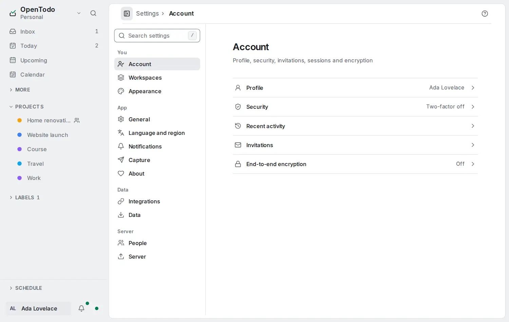

# Settings: You

<picture><source srcset="images/settings-dark.webp" media="(prefers-color-scheme: dark)"></picture>

The **You** group of [Settings](settings.md) holds your account and how the app looks for you.

## Account

- **Profile**: your initials, name, email and role, and [how you work](#how-you-work).
- **Security**: **Session** (sign out here or everywhere), **Password**, **Two-factor authentication**, **Passkeys** and **Linked accounts**; see [Account security](account-security.md) and [Single sign-on](self-hosting/sso.md).
- **End-to-end encryption**: encrypt your task text on your devices, and keep its recovery key. See [End-to-end encryption](e2ee.md).
- **Recent activity**: sign-ins and token changes from the last 90 days.
- **Invitations**: answer people who asked to add you to a project or workspace.

## How you work

**How you work** chooses how much the app shows [Open Loops](method/overview.md), its method for everything on your mind: **Simple lists**, **Lists with method hints** or **Full Open Loops method** (the Loop home first). It syncs to your devices and never changes a task; see [Set up in ten minutes](method/set-up.md). **Daily focus** is **Three tasks** or a [Bento](method/rhythms.md#bento), with its **Order** while Bento is on. **Energy levels** adds [task energy](method/set-up.md#energy-levels).
## Appearance

Three pages, **Theme and density**, **Sidebar** and **Task details**. These choices follow your account to every device, also offline:

- **Mode**: **System** follows your device's light or dark setting (the default), **Light** and **Dark** keep the app that way whatever the device says.
- **Theme**: the colour of buttons, links, the focus ring and selected items: **Emerald** (the default), **Blue**, **Indigo**, **Violet**, **Rose**, **Orange**, **Teal** or **Graphite**. Each tile previews its theme; the arrow keys move between them. On a phone the tiles are one scrollable row.
- **Density**: **Comfortable** (the default) or **Compact**, which makes task rows, group headers and the sidebar tighter. On a touch screen every target stays full size in both.
- **Task rows**: [one line or detailed](row-layouts.md).
- **Rows**: **Calm** (the default) leaves out of a task row what the view already says, colours only what needs attention and keeps the counts quiet until you hover; **Detailed** shows every chip and colour, as before. See [What a row shows](work-from-the-list.md#what-a-row-shows).
- **Motion**: on (the default), menus, dialogs and panels fade in gently. Switch it **off** and every change appears at once, on all your devices. When motion is on, your system's reduced-motion setting still applies.
- **Haptic feedback**: on a phone or tablet that can vibrate, a short tick when you complete a task or pick one up with a long press. On by default; turning it off on one device turns it off on all of them. Computers without vibration do not show the switch.
- **Open tasks** (Task details): **As a page** (the default) or **In a side panel** beside every list, from 1024 px wide. See [The task page](task-panel.md#open-tasks-beside-the-list).
- **Sidebar**: numbers on every list or only on Inbox and Today, the order of the main destinations, and which **More** destinations sit next to them; see [Sidebar counts and order](sidebar-counts-and-order.md). One switch per destination of the sidebar's **More** group (Anytime, Someday, Assigned to me, Completed, Updates, Trash, Filter) moves a destination up next to Inbox, Today, Upcoming and Calendar. Under **Open Loops first** the sidebar follows the Places, so these switches wait, kept, until you choose **Lists only** or **Companion**.

Mode and theme apply at once, without a reload. They never change other people's app. Priority colours (P1 to P4), warnings and errors, and the colours of your projects, labels and views keep their meaning in every theme. The installed app's title bar follows the theme too; its splash screen stays neutral. Every theme meets the same contrast rules in light and dark.
